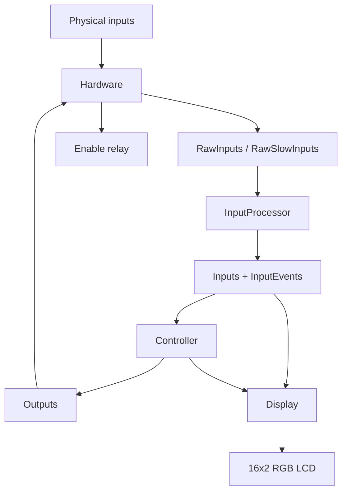

# Architecture

Status: implemented structure checked against the 13 November 2026 source snapshot. Hardware performance remains a separate validation activity.

## Layers and data flow



`Hardware` owns GPIO access and ADC acquisition. `InputProcessor` converts electrical observations into semantic values. `Controller` owns sequencing and output permission. `Display` presents controller/input state. `src/main.cpp` constructs configuration and schedules these components.

The controller does not interpret voltage levels or ADC counts. For example, `positiveSupply.hvOn` means HV is reported active, regardless of whether the hardware interface is active-high or active-low.

## Source layout

```text
platformio.ini
src/main.cpp
lib/Controller/{Types.h,Controller.h,Controller.cpp}
lib/InputProcessor/{RawInputs.h,RawSlowInputs.h,InputProcessor.h,InputProcessor.cpp}
lib/Hardware/{Pins.h,Hardware.h,Hardware.cpp}
lib/Display/{Display.h,Display.cpp}
test/test_controller/test_controller.cpp
test/test_input_processor/test_input_processor.cpp
backup/main debug.cpp.backup
README_TODO.txt
```

The earlier suggestion to split `MainApp` and `DiagnosticApp` into separate files has not been adopted. Both application branches are in one `main.cpp` under `#ifdef DIAGNOSTIC_MODE`. The backup is outside the active source directories.

## Data contracts

| Type | Responsibility |
|---|---|
| `RawInputs` | Run-switch and supply GPIO levels; averaged selector ADC |
| `RawSlowInputs` | Timer/target pots and four monitor ADC readings |
| `Inputs` | Raw and debounced run-switch states, decoded interlock/polarity, timer, target/monitor values and validity, supply status |
| `InputEvents` | One-update debounced ON/OFF transitions; reset on each `update()` |
| `RunConfig` | Captured polarity and duration in milliseconds |
| `Outputs` | Semantic `enableHv` request |
| `InputCalibration` | ADC windows, timer mapping, lookup tables, polarity flags, debounce |
| `ControllerConfig` | Current source: only `useSupplyFaultInputs` |

The inspected types contain no cable-polarity model or cable-detection configuration. Earlier designs did; see [IMPLEMENTATION_STATUS.md](IMPLEMENTATION_STATUS.md).

## Production startup

`setup()` starts serial at 115200, initializes hardware, reads and interprets fast/slow inputs, initializes the controller, applies its disabled output, and initializes the display. `Hardware::begin()` configures ENABLE as an output and writes LOW before configuring the remaining pins. This describes application initialization, not the electrical state throughout reset or bootloader execution.

The first controller update performs the `STARTUP` self-check. `InputProcessor::begin()` seeds both run-switch representations from the physical reading; a switch ON at boot therefore does not have to wait for debounce to be detected.

## Scheduling

Every production loop performs:

```text
read fast inputs -> interpret -> controller update -> apply relay output
then, when due: slow inputs -> display -> serial debug
```

| Work | Current scheduling / acquisition |
|---|---|
| Fast path | Every loop; selector ADC averages 250 fresh samples |
| Slow path | Every 100 ms when the loop reaches it; 100 samples per ADC channel |
| Display | Every 100 ms when due |
| Normal debug | Every 100 ms when due |
| Diagnostic output | Every 250 ms when due |

These are cooperative scheduling periods, not guaranteed response deadlines. ADC reads, serial writes, and LCD operations take time. `now = millis()` is captured before the fast ADC acquisition; latency must be measured on hardware.

Fresh local accumulation per channel replaces the earlier shared rolling-buffer design that mixed histories from unrelated ADC channels. Timing uses unsigned elapsed subtraction to support normal `millis()` rollover for these short intervals.

## Measurements and outputs

Target estimates use the currently selected polarity. Monitor conversion uses `measurementPolarity()`: captured run polarity is preferred in `STARTING`, `RUNNING`, `STOPPING`, `COMPLETE`, `ABORTED`, and `FAULT` when available. This avoids switching monitor interpretation simply because the selector moves during a fault or transition.

Timer and polarity are captured on successful validation; voltage/current pots are not captured. The firmware exposes one enable output and does not implement closed-loop voltage/current regulation or a software polarity-selection output.

`deriveOutputs()` begins with disabled output and permits enable only in the two explicitly allowed cases. The hardware layer maps semantic enable to GPIO23 HIGH. See [STATE_MACHINE.md](STATE_MACHINE.md) for the transition contract and [SAFETY.md](SAFETY.md) for limits.
