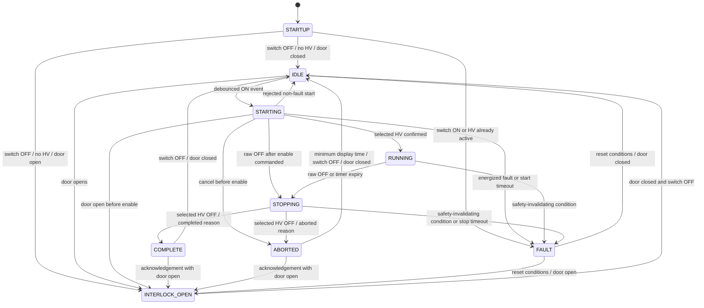

# State machine

Status: current implementation inspected; 30 existing controller tests pass on the host. Tables describe the code unless marked agreed or review. See [SAFETY.md](SAFETY.md) for differences between intended invariants and current coverage.

## States and output permission

Numeric values below are the current `State` declaration order, useful for interpreting serial logs; names are the durable contract.

| State | Log value | Meaning | `enableHv` |
|---|---:|---|---|
| `STARTUP` | 0 | Startup self-check | false |
| `IDLE` | 1 | Ready for a fresh start request | false |
| `STARTING` | 2 | Validation or waiting for selected HV feedback | true only in `WAITING_FOR_HV_ON` |
| `RUNNING` | 3 | Confirmed active treatment | true |
| `STOPPING` | 4 | Disable commanded; await selected HV OFF | false |
| `COMPLETE` | 5 | Requested time completed and selected HV OFF | false |
| `ABORTED` | 6 | Operator-cancelled/incomplete run | false |
| `INTERLOCK_OPEN` | 7 | Non-running readiness block | false |
| `FAULT` | 8 | Latched abnormal condition | false |



## Startup and start validation

`updateStartup()` checks switch ON first, then either supply reporting HV, then interlock readiness. Fault codes are respectively `STARTUP_SWITCH_ON` and `HV_PRESENT_BEFORE_START`.

`IDLE` accepts `events.runSwitchTurnedOn`, not a continually held ON level. A rejected configuration remains rejected until a fresh switch interaction; fixing the configuration while the switch stays ON does not auto-start.

`STARTING / VALIDATING` keeps enable OFF. Debounced OFF cancels to `ABORTED`. Door-open goes to `INTERLOCK_OPEN`. `checkStartConditions()` checks interlock, known polarity, positive HV already ON, then negative HV already ON. A successful check captures `RunConfig` and moves to `WAITING_FOR_HV_ON`; an unknown polarity rejects to IDLE. Pre-existing HV found during that validation faults. There is currently no cable check or supply-FAULT precheck in this function.

`STARTING / WAITING_FOR_HV_ON` commands enable. It checks raw switch OFF, interlock, internal run polarity, selector validity, wrong supply activity, and enabled supply-FAULT input; it enters RUNNING when the selected supply reports HV. Otherwise it faults after 500 ms. The **raw OFF check currently comes first**; concurrent-fault precedence in this phase is a review item.

## RUNNING priorities

`updateRunning()` evaluates these in order:

1. Valid captured polarity/supply references.
2. Interlock closed.
3. Selected polarity remains acceptable.
4. Inactive/wrong supply must not report HV ON.
5. Active supply FAULT, if configured.
6. Raw run-switch OFF: record `StopReason::ABORTED`, enter STOPPING.
7. Active supply unexpectedly HV OFF: `HV_LOST_WHILE_RUNNING`.
8. Timer expired: record `StopReason::COMPLETED`, enter STOPPING.

This preserves real safety-fault priority over ordinary cancellation/completion while classifying HV loss caused by physical operator OFF as cancellation. The timer starts on entry to RUNNING, not on initial ON or relay command. Later timer-pot movement cannot alter the captured duration.

An actual opposite polarity faults immediately. `UNKNOWN` begins a 100 ms grace interval; matching polarity resets it, while continuous UNKNOWN reaching the grace faults. The grace does not defer an explicit decoded interlock-open condition.

## Raw versus debounced run-switch race fix

The physical switch can remove the HV permission before the software's 50 ms debounce expires. The previous controller could see `runSwitchOn == true` and `hvOn == false`, then misclassify an operator stop as HV loss.

The implemented model is:

```text
physical pin -> rawRunSwitchOn     (updated each fast update)
             -> debounce -> runSwitchOn + one-cycle ON/OFF events
```

| Situation | Raw | Debounced | Required interpretation |
|---|---|---|---|
| Settled OFF | false | false | No start permission |
| Settled ON | true | true | Normal enabled operation, if otherwise valid |
| Newly switched OFF | false | true | Cancel energized operation immediately on the next update |
| Newly switched ON | true | false | Wait for stable ON event before a new start |

`InputProcessor::begin()` seeds both values; `update()` copies raw before debouncing. `RUNNING` checks raw OFF **before** HV-loss detection. `WAITING_FOR_HV_ON` uses raw OFF; `VALIDATING` uses debounced OFF as agreed in the later clarification.

The existing controller tests `test_operator_abort_with_immediate_hv_loss_is_aborted` and `test_raw_switch_off_prevents_false_hv_loss_fault` pass. Test helpers now set both representations for settled switch positions. The separately proposed InputProcessor raw-OFF-before-debounce regression is **not present** yet. See [TESTING.md](TESTING.md).

“Immediate” here means the next controller update after acquisition, not an interrupt or a guaranteed physical response time.

## STOPPING and result states

Enable is OFF throughout STOPPING. While the selected supply still reports HV ON, the controller checks interlock, polarity, wrong-supply activity, and configured active-supply FAULT. If HV stays ON for 500 ms, `HV_STOP_TIMEOUT` latches.

When the selected supply reports OFF, the saved reason chooses COMPLETE or ABORTED. A missing reason faults as `INVALID_INTERNAL_STATE`. **Current limitation:** this exit does not require both supplies OFF; wrong-supply checking is inside the selected-HV-ON branch. See the review items in [TODO.md](TODO.md).

COMPLETE waits for debounced switch OFF. ABORTED waits at least 2500 ms from entry plus debounced switch OFF. A closed door then permits IDLE; an open door routes to INTERLOCK_OPEN. Neither result resumes the previous treatment.

## Fault reset

Entering FAULT clears the reset-interaction marker and disables output. A subsequent debounced ON or OFF event sets that marker. Reset requires it, final debounced switch OFF, and **both** supplies reporting HV OFF. Reset clears the fault/run and returns to IDLE or INTERLOCK_OPEN according to the door.

If the switch was ON when the fault occurred, a subsequent OFF event can acknowledge it. If already OFF, merely staying OFF is insufficient: OFF → ON → OFF is required. That ON action acknowledges while in FAULT; it does not start HV.

Current reset logic does not separately require deassertion of supply-FAULT pins. Unexpected HV is checked at startup/start validation, not continuously in every non-running state. These are source-observed review items, not claims of verified hardware safety.
